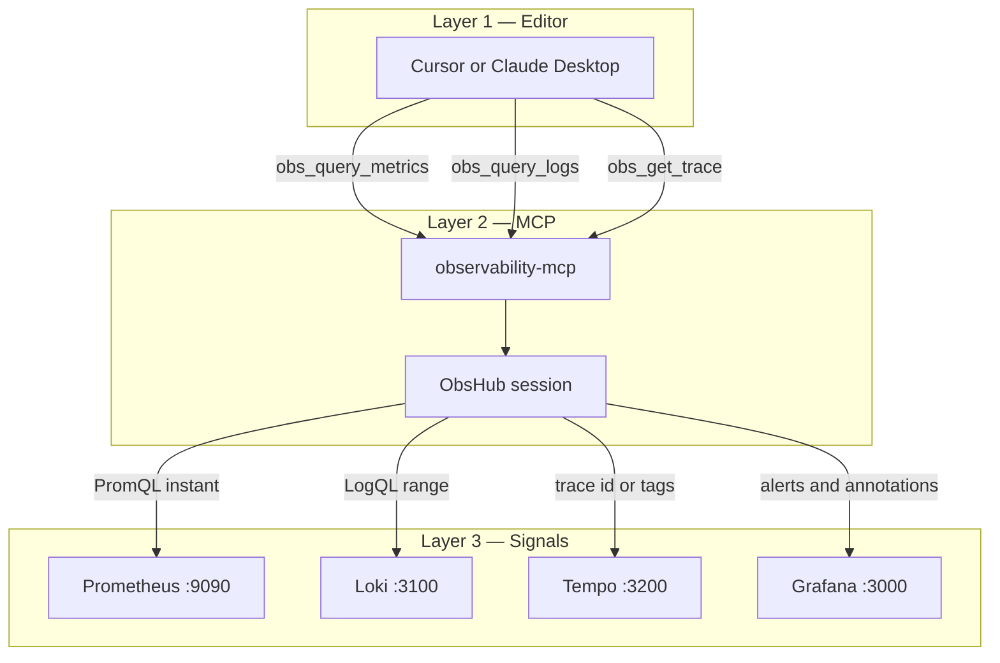
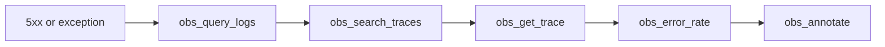

# Observability MCP Server

Open-source MCP server owned by **Pawan Gunjkar** (`pawangunjkar@gmail.com` · [GitHub](https://github.com/Pawangunjkar)). MIT licensed.

Developers ask why a request failed and get metrics, logs, and a trace without opening Grafana. Queries are read-only. `obs_annotate` is the only write: it posts a Grafana annotation.

Sibling servers: [github-mcp](https://github.com/Pawangunjkar/github-mcp), [jenkins-mcp](https://github.com/Pawangunjkar/jenkins-mcp), [db-mcp](https://github.com/Pawangunjkar/db-mcp), [k8s-mcp](https://github.com/Pawangunjkar/k8s-mcp).

## Project information

| Item | Value |
| --- | --- |
| Package | `observability-mcp` |
| Runtime | Python 3.10+, FastMCP, stdio, httpx |
| Backends | Prometheus, Loki, Tempo, Grafana |
| Reads | PromQL, LogQL, trace fetch, trace search, datasources, alert rules |
| Write | Grafana annotation only |

## Architecture





## Tools

| Tool | What it does |
| --- | --- |
| `obs_connect` | Save backend URLs and probe health |
| `obs_query_metrics` | Instant PromQL |
| `obs_error_rate` | 5xx rate for a `service` label |
| `obs_query_logs` | LogQL range query |
| `obs_get_trace` | Tempo trace by id |
| `obs_search_traces` | Tempo search by tags |
| `obs_grafana_datasources` | List Grafana datasources |
| `obs_grafana_alerts` | List alert rules |
| `obs_annotate` | Write a Grafana annotation |

Metrics, logs, and traces are read-only. The annotation tool is the write path.

## Cursor

```json
{
  "mcpServers": {
    "observability": {
      "command": "uv",
      "args": ["run", "--directory", "C:/AI_Workspaces/Anti_Workspace/observability-mcp", "server.py"],
      "env": {
        "PROMETHEUS_URL": "http://localhost:9090",
        "LOKI_URL": "http://localhost:3100",
        "TEMPO_URL": "http://localhost:3200",
        "GRAFANA_URL": "http://localhost:3000",
        "GRAFANA_TOKEN": ""
      }
    }
  }
}
```

Example: `obs_query_logs(query='{app="order-orchestrator"} |= "ERROR"', limit=50)`
