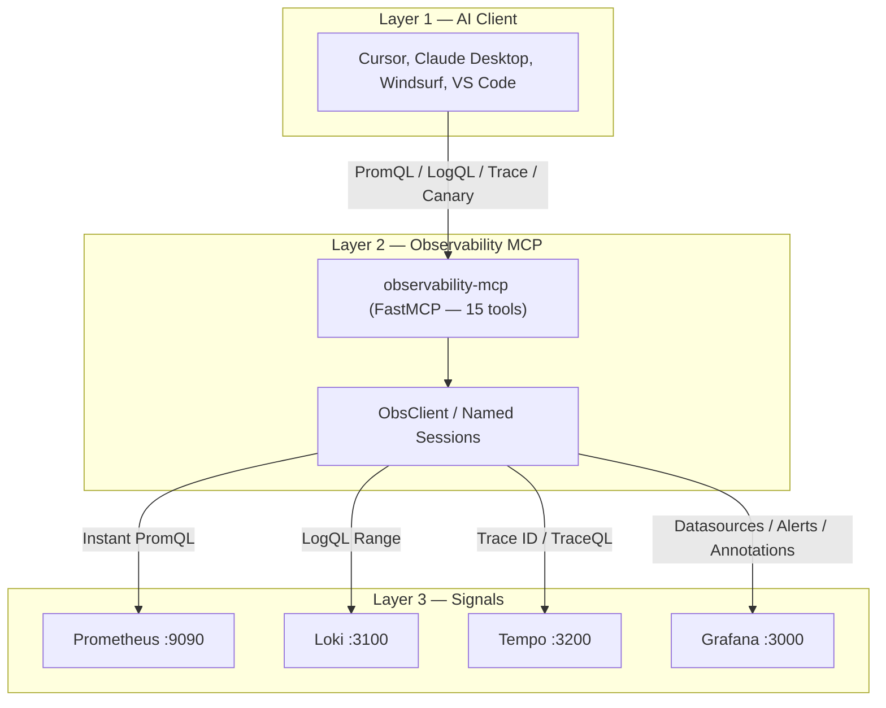
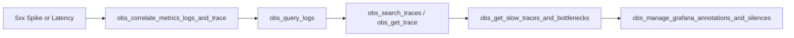

# Observability MCP Server

> A Python **Model Context Protocol (MCP)** server for **Prometheus, Loki, Grafana Tempo, and Grafana** — 15 SRE tools for PromQL metrics, LogQL logs, distributed traces, cross-signal incident correlation, slow-trace bottleneck detection, and post-deploy canary audits.

[](https://www.python.org/downloads/)
[](https://modelcontextprotocol.io/)
[](LICENSE)

---

## Overview

**Observability MCP Server** lets AI assistants investigate latency spikes, 5xx errors, and regressions across metrics, logs, and traces without switching between Grafana tabs.

- **Read-only queries by default:** Metrics, logs, traces, datasources, and alert rules are read-only.
- **Cross-signal correlation:** `obs_correlate_metrics_logs_and_trace`, `obs_post_deploy_canary_audit`, and `obs_get_slow_traces_and_bottlenecks` unify Prometheus, Loki, and Tempo in single investigative calls.
- **Explicit writes:** `obs_manage_grafana_annotations_and_silences` is the only mutating tool (for annotations and silences).
- **Named sessions:** `ObsHub` manages multiple named environments (`OBS_SESSION`, default `default`) with optional credential caching under `~/.observability-mcp-cache`.

---

## Architecture & Investigation Flow





---

## Project Layout

```text
observability-mcp/
├── src/observability_mcp/
│   ├── __init__.py          # Package metadata
│   ├── __main__.py          # `python -m observability_mcp` entry point
│   ├── server.py            # FastMCP server, 15 tools, /health, CLI transport
│   ├── obs_client.py        # Prometheus, Loki, Tempo, and Grafana HTTP client
│   └── credential_store.py  # Session credential persistence
├── tests/                   # Unit & httpx.MockTransport regression tests
├── pyproject.toml           # Hatchling config (`observability-mcp` CLI)
├── Dockerfile               # Streamable HTTP container
└── mcpize.yaml              # Hosted HTTP runtime config
```

---

## Tools Reference (15)

### Connection & Sessions (4)

| Tool | Description |
|---|---|
| `obs_connect` | Connect to Prometheus, Loki, Tempo, and/or Grafana and create a named session. |
| `obs_disconnect` | Disconnect an observability session. |
| `obs_status` | Show active sessions and configured backend URLs. |
| `obs_save_credentials` | Persist backend URLs and tokens to local cache for a session. |

### Metrics, Logs, Traces & Grafana (7)

| Tool | Description |
|---|---|
| `obs_query_metrics` | Run an instant PromQL query against Prometheus. |
| `obs_error_rate` | Compute HTTP 5xx error rate for a `service` label over the last 5 minutes. |
| `obs_query_logs` | Run a LogQL range query against Loki. |
| `obs_get_trace` | Fetch a single distributed trace from Tempo by `trace_id`. |
| `obs_search_traces` | Search Tempo traces by tag `key=value` pairs. |
| `obs_grafana_datasources` | List Grafana datasources with types and connection details. |
| `obs_grafana_alerts` | List Grafana-managed alert rules with current states (`firing`, `pending`, `normal`). |

### SRE Correlation & Incident Governance (4)

| Tool | Description |
|---|---|
| `obs_correlate_metrics_logs_and_trace` | Cross-signal incident correlator linking metrics, logs, and traces. |
| `obs_post_deploy_canary_audit` | Compare the 4 SRE Golden Signals before vs. after a deployment. |
| `obs_get_slow_traces_and_bottlenecks` | Find slow traces and identify the bottleneck service/span. |
| `obs_manage_grafana_annotations_and_silences` | Create a Grafana annotation or Alertmanager silence. |

---

## Installation & Configuration

Requires **Python 3.10+** and [uv](https://docs.astral.sh/uv/).

```bash
git clone https://github.com/Pawangunjkar/observability-mcp.git
cd observability-mcp
uv sync
uv run observability-mcp
```

### Environment Variables

| Variable | Default | Purpose |
|---|---|---|
| `PROMETHEUS_URL` | unset | Prometheus / Thanos / VictoriaMetrics base URL. |
| `LOKI_URL` | unset | Grafana Loki base URL. |
| `TEMPO_URL` | unset | Grafana Tempo base URL. |
| `GRAFANA_URL` | unset | Grafana server base URL. |
| `GRAFANA_TOKEN` | unset | Grafana API key or service account token. |
| `OBS_SESSION` | `default` | Default session name. |
| `OBS_TIMEOUT` | `30` | HTTP timeout in seconds. |
| `OBS_MCP_CACHE_DIR` | `~/.observability-mcp-cache` | Credential cache directory. |

### Cursor / Claude Desktop

```json
{
  "mcpServers": {
    "observability": {
      "command": "uv",
      "args": ["run", "--directory", "/absolute/path/to/observability-mcp", "observability-mcp"],
      "env": {
        "PROMETHEUS_URL": "http://localhost:9090",
        "LOKI_URL": "http://localhost:3100",
        "TEMPO_URL": "http://localhost:3200",
        "GRAFANA_URL": "http://localhost:3000",
        "GRAFANA_TOKEN": ""
      }
    }
  }
}
```

---

## Development & Tests

```bash
uv run python -m unittest discover -s tests -v
uv build
```

---

## Author & License

**Pawan Gunjkar** — pawangunjkar@gmail.com · [GitHub](https://github.com/Pawangunjkar)

MIT License — see [LICENSE](LICENSE).
